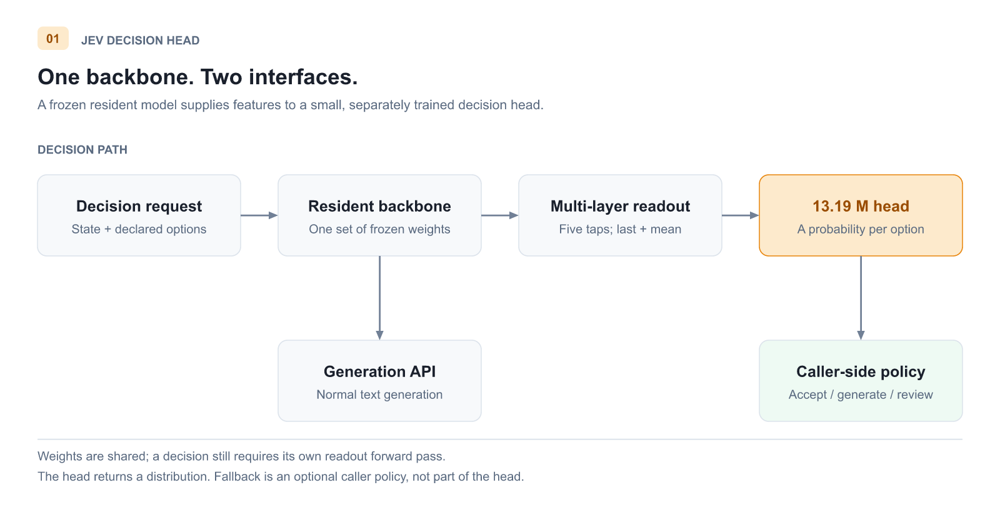
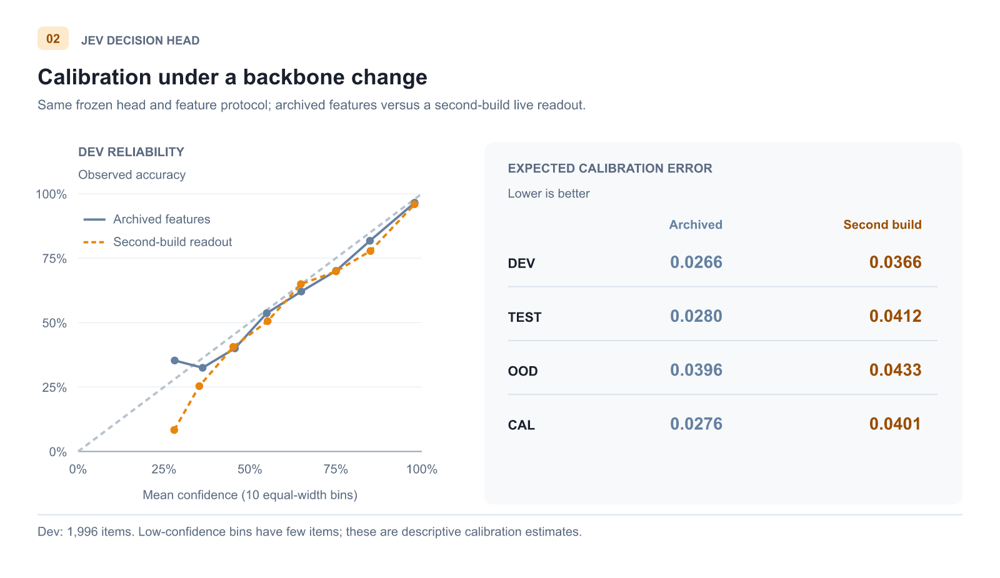
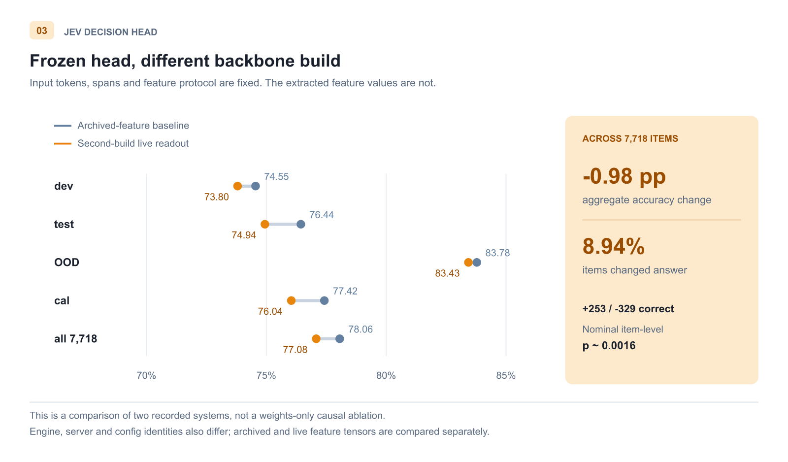
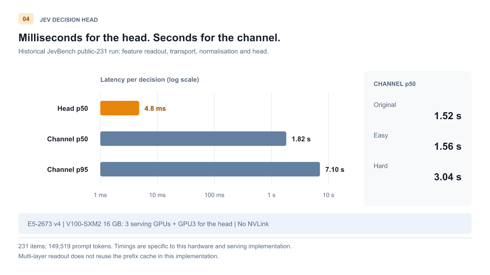
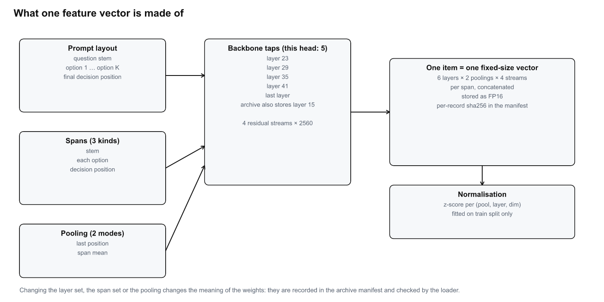
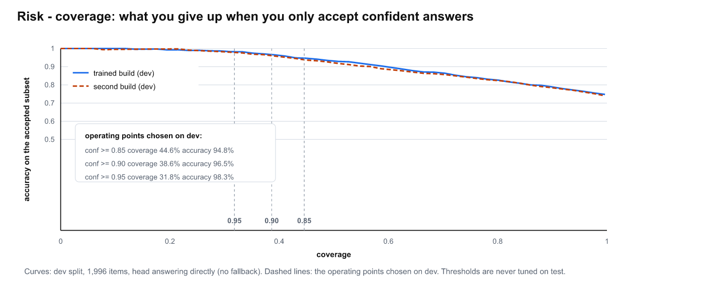
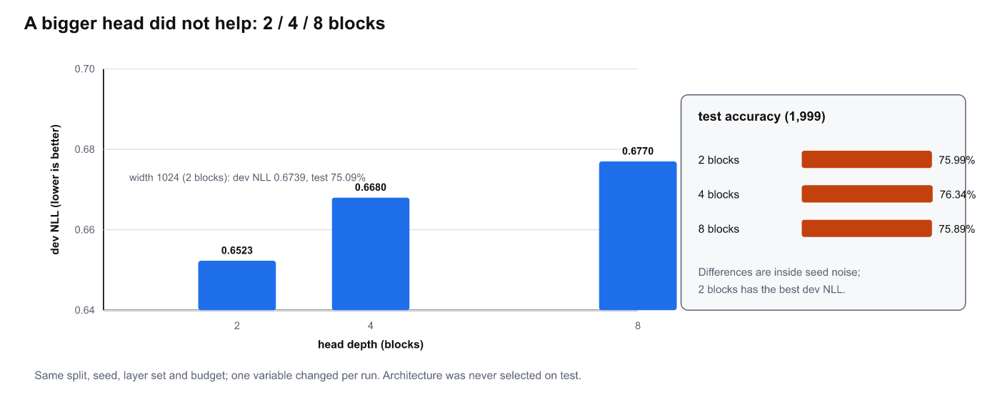
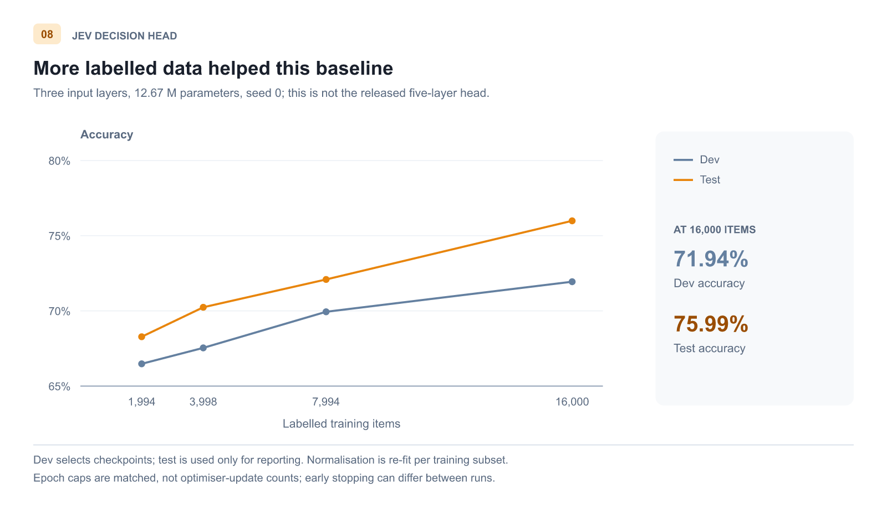

# Jev Decision Head

[](LICENSE)
[](LICENSE-WEIGHTS)


A lightweight Jev-style decision head, plus the Strata patches that let one resident Strata
process serve **both** LLM generation and Jev-style typed decisions from a single set of
weights. This repository ships the trained decision-head weights, the Strata interface
patches, and the training / evaluation code used to get the numbers below.

**The model the head was trained on**: `Qwen3.8-Flash-Next-GSQ-RCO IQ3_S`, served by Strata 0.1.44.1.
The head is a bolt-on: the base model is used as released, **no fine-tuning, no LoRA, no
gradient into it**. Every number in this README was produced by that base model unless a
paragraph says otherwise.

**A Jev-style decision**: the caller supplies a *state* (text or JSON) and a question whose
**answer space is declared up front** — a set of options, a yes/no criterion, or an ordered
rating scale. The model returns a probability distribution over exactly that space in a
single forward pass; no text is generated, so there is nothing to parse. Because the answer
space is known in advance, all candidates are scored in parallel inside one read of the
input instead of being decoded token by token. (Terminology follows the upstream typed-decision
interface and the JevBench methodology document; links in §8.)

On the 231 publicly released JevBench items this head answers **198/231 (85.71%)** while
running inside the same resident model process that serves chat — no second model, no second
copy of the hardware ([§2](#2-accuracy)).

**Try it yourself → [Quick start (§6)](#6-quick-start)**


*Figure 1. One resident backbone serves generation and decision readouts. A decision uses its
own forward pass, reading five backbone layers into a 13.19 M-parameter head; it does not
reuse the hidden states of a previous chat request for free.*

**Contents:** [1. Why this design](#1-why-this-design) · [2. Accuracy](#2-accuracy) ·
[3. Speed](#3-speed) · [4. How it works](#4-how-it-works) · [5. Strata patches](#5-strata-patches) ·
[6. Quick start](#6-quick-start) · [7. Training your own](#7-training-your-own) ·
[8. Data and weights](#8-data-and-weights)

## 1. Why this design

A serving stack that already keeps a large model resident has already paid to load it and to
understand the context. Adding a separate decision model means choosing between two bad
options: a model small enough to be cheap does not carry enough world knowledge and
generalises poorly to unseen tasks, while a model large enough to be good needs another
copy of the hardware.

We keep the typed-decision interface exactly as it is defined upstream, and move the readout
from the language-model head (or the probability of each option's text) to a small head over
the **intermediate representations of several backbone layers**, sharing the weights that are
already serving generation. The head is 13.19 M parameters (~50 MiB in FP32) and reads five
backbone layers; the backbone is never updated and no gradient flows into it.

The head returns a distribution. What you do with a low-confidence one — fall back to the
generation path of the same backbone, ask a human, refuse — is a caller-side policy; we ship
a router as a worked example, not as the subject of this work.

## 2. Accuracy

Every number is bound to the exact system that produced it: engine binary, server, service
config, model/tokenizer, head and normalisation parameters, and the compute backend. Unless a
paragraph says otherwise, all of it was produced by the model named above, with the head and
feature protocol shipped in this repository. `REPRODUCE.md` lists the hashes and the command
that produced each table.

The split names used in the tables mean:
**dev** (1,996) — checkpoint and threshold selection only; **test** (1,999) — final
evaluation, never used for selection; **OOD** (1,991) — task families and sources that never
appeared in training, i.e. a generalisation probe; **cal** (1,732) — a split held out for
temperature scaling / calibration. No item appears in two splits, and splitting is done by
parent group and semantics, never by id arithmetic.

### 2.1 Public benchmark — JevBench, 231 released items

The comparison below is not model-vs-model: our entry keeps a released base model **unchanged**
and adds a small head, while every other row is a complete model on its own.

| System | Base | Head | Correct / 231 | p50 latency |
|---|---|---|---|---|
| **Jev Decision Head (this repo)** | `Qwen3.8-Flash-Next-GSQ-RCO IQ3_S` | **13.19 M** (base untouched) | **198 (85.71%)** — identical for both option renderings | 1.82 s (see §3) |
| Jev 1.13.0 | closed (hosted API) | — | 200 (86.58%) | 291 ms |
| Open-Jev 27B v1.1 | Qwen3.5-27B | — | 197 (85.28%) | not printed |
| Open-Jev 9B | Qwen3.5-9B | — | 179 (77.49%) | 189 ms |
| Open-Jev 2B | Qwen3.5-2B | — | 150 (64.94%) | 138 ms |
| Kev 0.8B | Kev 0.8B | — | 138 (59.74%) | — |
| Laya typed-decisions | ModernBERT 421M | — | 124 (53.68%) | — |
| GPT-5.6 Luna | closed (hosted API) | — | 206 (89.18%) | 954 ms |
| GPT-6 Astra | closed (hosted API) | — | 231 (100%) | 2,206 ms |

Our run is a single pass with a live tokenizer, **231/231 strict-valid** probability vectors
(0 renormalisations), scored by the benchmark's own `scoring.py`; the two option renderings
(“label” vs “criteria”) both give 198/231, with only 3 items changing answer. A leakage check
against all 23,718 of our own items found 0 exact state matches, and we never trained, fitted
a temperature or chose a threshold on these questions. The public subset is 231 of the
benchmark's 534 items; the remaining 303 are not available to us, so this is **not** an
official Intelligence / Calibration / Capability score and not a leaderboard rank. Latency is
not comparable to a hosted decision API (§3). Third-party rows are quoted from their authors'
published runs ([Open-Jev benchmarks](https://zefan-cai.github.io/open-jev/benchmarks/),
[Jev News public-subset table](https://jevainews.com/compare/),
[OpenDecisions / Inner Jev, Table 3](https://arxiv.org/html/2610.17205)); we did not rerun
them.

### 2.2 Held-out splits (7,718 items)

These splits are derived from public decision datasets —
the `community-hard-mix-v2-redistributable` configuration of
[ZefanCai/Open-Jev-v1.1](https://huggingface.co/datasets/ZefanCai/Open-Jev-v1.1).
The repository ships split membership, grouping, targets and hash commitments, not their task text.
The selected 23,718 members match that public projection; OOD control/workflow categories are
public-source categories, not additional project-private tasks. Exact lineage and applicable terms:
[docs/DATA.md](docs/DATA.md) and [NOTICE](NOTICE).

| Split | accuracy | ECE |
|---|---|---|
| dev (1,996) | 74.55% | 0.0266 |
| test (1,999) | 76.44% | 0.0280 |
| OOD (1,991) | 83.78% | 0.0396 |
| cal (1,732) | 77.42% | 0.0276 |

These are held-out numbers from the base model named at the top; the checkpoint and every
threshold were chosen on dev alone. Note that the benchmark's 85.71% and our test 76.44% are
different distributions and splits — they are not comparable and not a progress curve.


*Figure 2. Dev reliability and ECE by split: the same frozen head scores archived features
and second-build live readouts. Shared feature protocol does not imply identical feature values.*

### 2.3 Portability: the head belongs to one model build

We re-ran the **frozen** head, with the archived features and identical input tokens, against
a second build of the same model (different weights, `…-abliterated-IQ3_S`). Nothing in the
head or the feature protocol changed. Accuracy moved 78.06% → 77.08% over 7,718 items
(+253/−329, z = −3.15, p ≈ 0.0016); on test alone −1.50 pt, McNemar p = 0.027; 8.94% of items
changed their answer, and ECE rose (dev 0.0266 → 0.0366, test 0.0280 → 0.0412, OOD 0.0396 →
0.0433, cal 0.0276 → 0.0401). Applying a temperature fitted on the first build made
calibration worse rather than better. Per-family effects do not extrapolate: on test the loss
concentrates in choice items (−2.68 pt) while score items gain (+3.09 pt), and on OOD choice
items gain (+1.06 pt).

That is the reason for the identity machinery in §4: a decision head is not portable across
model builds for free, and any number you publish has to name the build it came from.


*Figure 3. Fixed head, token IDs, spans and feature protocol; archived-feature baseline versus
second-build live readouts. Feature values and serving-stack identities differ, so this is not
a weights-only causal ablation.*

## 3. Speed

Measured on this machine; please quote it together with the numbers.

| Component | Configuration |
|---|---|
| CPU | Intel Xeon E5-2673 v4 @ 2.30 GHz (40 threads) |
| GPU | 3× Tesla V100-SXM2 16GB in use (a fourth is installed and unused) |
| RAM | 94 GB |
| NVLink | none |

- The head itself: **4.8 ms** per decision once features are available.
- The whole decision channel (read the prompt + read out + score): **p50 1.82 s / p95 7.10 s**
  over the 231 public items (149,519 prompt tokens, 645 s wall clock). Per tier: original
  1.52 s, easy 1.56 s, hard 3.04 s — the long policy/multi-hop prompts dominate p95.
  Essentially all of that is reading the prompt once; a request with multi-layer readout does
  not reuse the prefix cache by design (at equal length it costs ~0.1 s more than a plain
  chat request).

This is a 2016-era platform's prefill bandwidth, **not the cost of the method**. On a modern
GPU (more memory, higher bandwidth, prefix caching) that part drops substantially; the head
cost stays at the millisecond level.


*Figure 4. Head cost versus channel cost, and channel p50 by prompt tier.*

## 4. How it works


*Figure 5. Spans, layers and pooling that define one feature vector.*

- **Input layout.** Full prompt + all candidates + the final decision position. Readouts are
  taken over several text spans: the question stem, each candidate, and the decision position.
- **Readout.** The archive stores 6 backbone layers (15/23/29/35/41/last) × 2 pooling modes
  (last position, span mean) × 4 residual streams. **This head reads 5 of them**
  (23/29/35/41/last); the per-record feature vector is stored as FP16 with a per-record hash.
  The layer set and span set are part of the feature protocol: changing them changes the
  meaning of the weights, so they are recorded in the archive manifest
  (`prompt_version: lossless-state-final-assistant-token-v2`).
- **Head.** Shared projection → candidate-set encoder (candidates see each other) → one score
  per candidate; 13.19 M parameters. Trained against soft targets; the checkpoint is selected
  on dev NLL only, with early stopping on no improvement.
- **Normalisation.** Layer scales differ by a factor of ~33, so a per (pool, layer,
  dimension) z-score is required; it is fitted on train data only and shipped with the head.
- **Router (example policy).** Confidence / margin / normalised entropy decide whether to
  accept the head's answer. Thresholds are chosen on an independent dev split only; if no
  operating point is feasible, everything falls back. The shipped
  `policies/dev-thresholds.json` was produced by `jev/tune_policy.py` from the dev predictions
  in `baselines/` alone: `min_confidence 0.80`, `min_margin 0.05`,
  `max_normalised_entropy 0.40` → 42.2% coverage at 95.5% accuracy on dev. On dev alone,
  `conf ≥ 0.85` accepts 44.6% of items at 94.8% accuracy; `conf ≥ 0.95` accepts 31.8% at 98.3%.


*Figure 6. Accuracy on the accepted subset as a function of coverage, head answering directly.*

- **Depth does not buy accuracy.** With everything else fixed, 2 / 4 / 8 transformer blocks in
  the head give dev NLL 0.6523 / 0.6680 / 0.6770 and test accuracy 75.99 / 76.34 / 75.89% —
  inside seed noise, and 2 blocks has the best dev NLL. A wider head (d = 1024) was also worse
  on dev NLL (0.6739). We report this as a negative result rather than picking the best test
  number.


*Figure 7. Single-seed head-depth ablation (seed 0), with matched input layers, width and
training-budget policy. Architecture is selected on dev NLL, never on test.*

- **Identity binding.** Every evaluation records the running system's binary/config/weight
  hashes and re-verifies them during the run; if the service changes mid-run, the run refuses
  to continue.

## 5. Strata patches

One consolidated patch against Strata 0.1.44.1 is needed on the serving side:
`patches/0001-strata-v0.1.44.1-jev-readout.patch`, applied to clean upstream
`296b59d2f73c8f04a805df29c2fa97655adace78` (tag `v0.1.44.1`). It is not an addition to the
former five-patch 0.1.41 chain — the retired files and every before/after source hash are
recorded in `patches/manifest.json`, and `patches/README.md` plus `docs/PATCHES.md` give the
technical report. Do not apply patches by glob, and do not apply this to an already-customised
tree.

What the patch adds:

| Area | What it changes | Why it is needed |
|---|---|---|
| session KV retention | preserves a chat slot's KV across pipeline stages (`serve/server.py`, `src/program/generate.cpp`) | prevents loss of resident chat context; decision readouts still use their own forward pass and do not reuse chat KV |
| readout path | adds the readout request path and the capability bit the client checks (`src/program/generate.cpp`) | the head scores hidden states; generating text and parsing it is slower and loses the distribution |
| multi-layer taps | one forward pass can be read at several layers, with schema validation (`generate.cpp`, `src/core/verify.cpp/.hpp`, `serve/server.py`) | the protocol reads six layers; six passes would multiply the prefill cost |
| spans and pooling | span selection (stem / each option / decision position) and pooling (last, span mean) on the engine side | if engine and training extractor disagree about spans, the weights mean something else |
| decision region | defines the decision region and fixes the tap read path to it | a readout taken from the wrong position silently produces a different feature |

Build it with one command on the serving host:

```sh
GGML_DIR=/path/to/audited-pinned-llama.cpp \
  bash patches/reproduce-build.sh /tmp/strata-repro-NEW
```

It checks out the pinned commit, applies the patch, verifies the patched bytes against
`patches/manifest.json`, configures with the deployment's options and builds. Clean patch
application and compilation are verified (`patches/evidence/validation-{local,linux}.json`).
A rebuilt binary will not be byte-identical to the ones we ran - build paths and toolchain
leak into the image - and it does not need to be: the client contract is the readout API
the patch adds, checked at startup by `python -m jev.identity`.

Historical measured effect: 402/512/950-token batched-prefill requests ran 1.62× / 2.32× /
2.87× faster than the serial small-window path (107 tok/s).

Multi-layer readout does not reuse the prefix cache. Features depend on expert placement;
CPU-verified and GPU batched-prefill features are not interchangeable. The capability bit is
reported only under `batch_groups ≤ 2`; unsupported modes fail rather than silently degrade.

## 6. Quick start

```
jev/         client, harnesses, selfcheck (torch + stdlib only)
weights/     head weights + normalization (SHA-256 pinned in WEIGHTS.md)
patches/     Strata readout patch, pinned build recipe, validation evidence
manifests/   split membership, system identities, data lineage, verifiers
benchmarks/  JevBench public 231 items + frozen upstream scorer
baselines/   per-item dev baseline for check_baseline.py
results/     archived-feature held-out metrics
identity/    runtime identity captures from measurement runs
policies/    dev-only router thresholds
evidence/    isolated-install, live smoke and validation records
docs/        DATA / PATCHES / IDENTITIES detail; docs/fig/ the eight figures
serve/       example launch script (exact config pinned in REPRODUCE.md §0a)
tests/       offline contract tests (no server, no GPU)
```

```bash
# 0. dependencies, then an offline self-check that needs no server, no GPU and no
#    training workspace: it loads the published weights, runs a forward pass, and
#    checks the geometry, policy and benchmark snapshot
python -m pip install -r requirements-cpu.txt   # tested CPU dependency profile
python -m jev.selfcheck

# 1. on the serving host: clone the pinned Strata upstream, apply the readout patch
#    and build the engine - one command (needs CMake, a C++ toolchain, CUDA 12 and the
#    pinned llama.cpp source containing ggml/; Strata links ggml, the tensor library
#    from llama.cpp, as its backend - the exact llama.cpp commit and ggml tree digest
#    are pinned in patches/manifest.json. Recipe details and overrides:
#    patches/README.md and REPRODUCE.md section 0a):
GGML_DIR=/path/to/pinned-llama.cpp bash patches/reproduce-build.sh /tmp/strata-build
#    then start the patched server: serve/launch.example.sh shows the shape of the
#    launch; our exact launch configuration is pinned in REPRODUCE.md section 0a.

# 2. record the runtime identity (required, not optional)
python -m jev.identity --base http://127.0.0.1:8100 --out identity/runtime-identity.json

# 3. score one item with the shipped head (--tokenizer-dir is the served model's
#    tokenizer directory: descriptor + vocab.json + merges.txt + token_type.json + chat_template.jinja)
python -m jev.predict --identity identity/runtime-identity.json \
  --tokenizer-dir /path/to/served/tokenizer \
  --state '{"ticket": "T-1", "unpaid_days": 12}' \
  --question 'Route this ticket to billing?' \
  --options yes no --out decision.json

# 4. or use the router (thresholds from dev only; the shipped file is policies/dev-thresholds.json)
python -m jev.cascade --identity identity/runtime-identity.json \
  --tokenizer-dir /path/to/served/tokenizer --items items.jsonl --out predictions.jsonl

# 5. keep the identity file from step 2 with every result set: it records exactly
#    which engine / server / config / tokenizer answered your requests
python -m jev.predict --identity identity/runtime-identity.json \
  --tokenizer-dir /path/to/served/tokenizer --state '{...}' --question '...' \
  --options yes no --out measurement.json
```

The client runs against any patched Strata server. `python -m jev.identity` records which
engine / server / config / tokenizer answered, and the harnesses refuse to keep going when
that build changes mid-run. Our exact environment - upstream commit, patch, build recipe,
model pack and hashes - is pinned in `REPRODUCE.md` §0a.

**Acceptance status.** Online measurement passed a single-item call, 20 valid head
distributions, forced generation fallback, and a four-item natural cascade with both
routes. Token IDs and all spans matched the pinned Strata tokenizer/template on 20 prompts.
This is interface acceptance, not a new performance estimate.

The original 20-item smoke rows could not be recovered. A separately identified first-20 subset
was derived from the original full archived-dev results; it agrees with the accepted baseline
20/20 and is not a recovered live result. Historical live-vs-archive evidence remains 3/20 answer
flips and 0/20 fully byte-identical vectors. Recompute the derived comparison without a server:

```bash
python -m jev.check_baseline \
  --rows evidence/smoke-20-dev-20261020/rows-smoke20-derived-archive-v2.jsonl \
  --expected-count 20
```

A clean isolated CPU installation passed dependency resolution, unit tests and selfcheck.
One earlier selfcheck run in that environment hit an unexplained native crash that later
passes did not reproduce; the records are in `evidence/dependency-install-20261020/`.
Full status and evidence: [REPRODUCE.md](REPRODUCE.md).

## 7. Training your own

```bash
# extraction runs inside the Strata source tree: it uses the served model's tokenizer stack
python -m jev.extract --base http://127.0.0.1:8100 --items items.jsonl \
        --layers 23,29,35,41,-1 --out archive/shard-00000
python -m jev.train --shards archive/shard-00000 archive/shard-00001 \
        --out runs/middle5-s1 --layers 23,29,35,41,-1 --seed 1 --epochs 8
```

`jev/experiments.json` is the pre-registered experiment matrix: one variable per run, fixed
splits / seeds / layer sets / budget. `jev/check_baseline.py` re-checks a run against a known
prediction file so a framework bug is never mistaken for a model change.

Labelled-data volume was the variable that kept paying: with everything else fixed, 2k / 4k /
8k / 16k train items give dev accuracy 66.48 / 67.54 / 69.94 / 71.94% and test accuracy
68.28 / 70.24 / 72.09 / 75.99%.


*Figure 8. Training-scale curve for the three-input-layer, 12.67 M-parameter baseline
(seed 0), not the released five-input-layer head. Normalisation is re-fit per training subset;
epoch caps, rather than optimiser-update counts, are matched.*

## 8. Data and weights

| Item | Where it comes from | Redistributed here |
|---|---|---|
| Public benchmark | [JevBench](https://jevbench.dev/) · [pinned source](https://github.com/fstandhartinger/jevbench/tree/7625ecb1b075cfe4d09d34141d353325825eea1d) | yes: public 231 tasks and scorer, upstream MIT license; no sealed tasks |
| Decision datasets behind our splits | `ZefanCai/Open-Jev-v1.1`, `community-hard-mix-v2-redistributable`; see `docs/DATA.md` and `NOTICE` | no task text; membership/targets/hash commitments only |
| Our splits (dev 1,996 / test 1,999 / OOD, cal) | derived from the above, isolated by parent group and semantics — never by id arithmetic | no; manifest + hashes |
| Feature archives | produced by `jev.extract` | no; hashes in the archive manifest |
| Backbone weights | `Qwen3.8-Flash-Next-GSQ-RCO IQ3_S` (the model this head was trained on) | no (re-distribution unconfirmed) |
| **Head weights + normalisation** | this repository (`weights/best.pt`, `weights/norm.npz`) | **yes** |

## 9. Licence

Original code, patches, figures and docs: Apache-2.0 (`LICENSE`). The trained head weights
and normalization (`weights/`): CC BY 4.0 (`LICENSE-WEIGHTS`) — requested attribution:
"LittleSatellite233 - jev-decision-head decision-head weights". Upstream-derived portions
retain their own terms: the public-231 benchmark and scorer and the vendored Strata
tokenizer keep their upstream MIT notices. Training split text, feature archives and
backbone weights are not redistributed. See `NOTICE` and §8.
